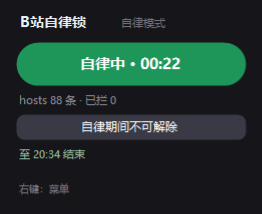
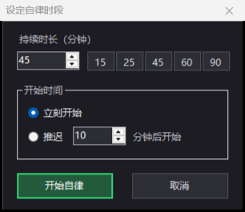

# B站自律锁 · BiliLock

一个只有 **33 KB** 的 Windows 桌面小工具，用来在设定的时间段里封锁B站以实现强制自律效果。

它不装驱动、不挂浏览器扩展、不联网，只做三件事：改 `hosts` 断域名、盯着窗口关掉 B 站页面、在自律期间把封锁重新加固。适合备考、赶作业、ddl 前那种「我知道我不该点，但我就是想点」的时刻。


## 特性

- **三层拦截**：`hosts` 域名层 + 窗口标题层 + 浏览器 DoH 层，互相补位。
- **自律时段**：设定「持续多久」和「何时开始」（立刻开始 / N 分钟后开始），到点自动封锁、到点自动解除。
- **期间不可解除**：时段内主按钮只弹提示，右键菜单与关闭窗口全部拒绝，`hosts` 被改回去会在 1~2 秒内自动补回。
- **单实例 + 一键隐藏**：重复双击只会唤起已有面板，不会开出一堆窗口；右上角「隐藏」把面板收起来，封锁继续生效。
- **可逆**：首次开启前备份原 `hosts`，解除时按原内容逐字节还原；一条右键菜单即可恢复原状。
- **纯本地**：无网络请求、无第三方依赖、无后台服务，单文件 exe。

## 截图

| 已封锁 | 自律中 |
| --- | --- |
|  |  |

| 排程中（可取消） | 设定时段 |
| --- | --- |
|  |  |

## 快速开始

1. 下载或双击 `B站自律锁.exe`（Windows 10/11，自带 .NET Framework 4.8 即可运行，无需安装）。
2. 面板出现在屏幕右下角，可拖动，位置会记住。
3. 点「已放行 · 点我封锁」→ UAC 点「是」→ 变成「已封锁 · 点我解除」。
4. 想要定时自律：点「设定自律时段…」→ 填时长、选开始方式 → 确认。

> 改 `hosts` 必须有管理员权限，所以每次开关都会弹一次 UAC。这是唯一的权限要求。

## 使用方法

### 手动开关

- 绿色「已封锁 · 点我解除」= 当前封锁中，点一下解除。
- 灰色「已放行 · 点我封锁」= 当前未封锁，点一下开启。

### 设定自律时段

- **持续时长**：直接填分钟，或点 `15 / 25 / 45 / 60 / 90` 快捷键。
- **开始时间**：`立刻开始` 或 `推迟 N 分钟后开始`。
- 确认后会再弹一次确认框；推迟开始时面板显示「已排程 · 点我取消（mm:ss 后开始）」，**开始前可以取消**。
- 时段内面板变成「自律中 · 剩余 mm:ss」，不提供解除入口；结束后自动解除并提示一次。

### 隐藏与唤出

- 面板右上角「隐藏」→ 面板消失，封锁与窗口守卫照常运行。
- 再双击一次桌面上的 `B站自律锁.exe` → 面板重新出现（不会多开）。

### 右键菜单

| 菜单项 | 说明 |
| --- | --- |
| 设定自律时段… | 打开时段设置；自律中不可用 |
| 还原 hosts 并退出 | 清掉封锁段、恢复 DoH 策略后退出；自律中不可用 |
| 退出（保持当前封锁） | 只关面板，封锁继续；自律中不可用 |
| 切换拦截动作（关窗口 / 最小化） | 默认关窗口，可改为最小化 |

## 工作原理

### 1. 域名层（hosts）

开启时在 `C:\Windows\System32\drivers\etc\hosts` 追加一段带标记的封锁块，共 **88 条**记录（46 条基础规则 + `www.` 变体），覆盖：

`bilibili.com` 全系子域（`live` / `api` / `space` / `t` / `message` / `passport` / `search` …）、`hdslb.com` 图床、`bilivideo.com` 视频 CDN、`b23.tv` 短链、`biliapi.net` 接口、`biligame.com`、`bilibili.tv` 等。

解除时按写入的块做**精确反向替换**，原文件逐字节还原（实测 SHA256 一致），并保留首次备份 `hosts.bililock.bak`。

### 2. 窗口层（每 300 ms）

枚举可见顶层窗口，命中以下任一条件即处理：

- 标题包含 `bilibili` / `哔哩` / `b23.tv` / `hdslb` / `bilivideo`
- 进程名包含 `bilibili` / `哔哩`

处理方式默认是发送 `WM_CLOSE`，也可在右键菜单切换为「最小化」。这一层负责兜住 `hosts` 拦不住的情况：镜像站、IP 直连、被别的程序拉起的页面、弹窗。

### 3. DoH 层

浏览器开启「安全 DNS（DoH）」后会绕过 `hosts`。封锁期间程序会写入策略：

```
HKCU\Software\Policies\Microsoft\Edge   DnsOverHttpsMode = off
HKCU\Software\Policies\Google\Chrome    DnsOverHttpsMode = off
```

解除时删除这两个值。**需要重启浏览器后生效。**

### 4. 自律时段的自愈

- 时段存在 `%APPDATA%\BiliLock\session.txt`，重开程序不丢。
- 每 1.5 秒检查一次 `hosts`，封锁段被移除就立刻补回。
- 程序被强杀后重开，若时段仍在进行而封锁缺失，会提权自动补回。

### 5. 单实例

用命名互斥体 `Local\BiliLock.SingleInstance`（加命名事件 `Local\BiliLock.ShowPanel`）保证只跑一个进程：新实例只负责把旧实例的面板唤出，然后自己退出。

## 构建

不需要 Visual Studio，用系统自带的 `csc.exe` 即可：

```powershell
# 在项目根目录执行
powershell -ExecutionPolicy Bypass -File .\build.ps1
```

或手动：

```powershell
& "$env:WINDIR\Microsoft.NET\Framework64\v4.0.30319\csc.exe" `
  /nologo /target:winexe /platform:anycpu /optimize+ /codepage:65001 `
  /r:System.dll /r:System.Drawing.dll /r:System.Windows.Forms.dll /r:System.Core.dll `
  /win32manifest:src\app.manifest `
  /out:B站自律锁.exe src\BiliLock.cs
```

产物是单个 exe，无外部依赖。

## 目录结构

```
B站自律锁/
├─ B站自律锁.exe        编译好的程序（33 KB）
├─ build.ps1            一键编译脚本
├─ README.md            本说明
├─ LICENSE              MIT
├─ src/
│  ├─ BiliLock.cs       全部源码（单文件，约 1170 行）
│  └─ app.manifest      清单（DPI 设置等）
└─ docs/                截图
```

## 已知限制

- **`hosts` 不支持通配符**：子域是枚举的常见清单，冷门子域靠窗口层兜底。
- **DoH 需要重启浏览器**才能完全生效；部分浏览器内核自带的加密 DNS 不受策略管辖。
- **窗口关闭受权限限制**：如果浏览器以管理员权限运行，普通权限的程序无法向它发送 `WM_CLOSE`，此时面板会出现「失败 N」计数，可改用「最小化」模式。
- **这是自律工具，不是家长控制**：以管理员身份手动改 `hosts`、或结束进程，都可以绕过。它的目标是拦住「顺手点一下」的自己，不是防住有备而来的自己。
- 仅支持 Windows（WinForms，依赖 .NET Framework 4.8，Windows 10/11 默认自带）。

## 如何彻底恢复

任选其一：

1. 右键面板 →「还原 hosts 并退出」；
2. 手动删除 `hosts` 中 `# >>> BiliLock BLOCK BEGIN` 到 `# <<< BiliLock BLOCK END <<<` 之间的内容，再执行 `ipconfig /flushdns`；
3. 用首次备份覆盖：`copy hosts.bililock.bak hosts`。

程序不会写注册表常驻项、不装服务、不开机自启，删掉 exe 即可卸载（记得先恢复 `hosts`）。

## 许可

[MIT](LICENSE)

## 免责声明

本项目仅供个人自律与学习使用，与哔哩哔哩（bilibili）官方无关。请自行确认修改 `hosts` 与浏览器策略对你自己环境的影响；在共享设备或他人设备上使用前，请征得设备所有者同意。本README.md乃至全程序均由Deepseek Harness完成。